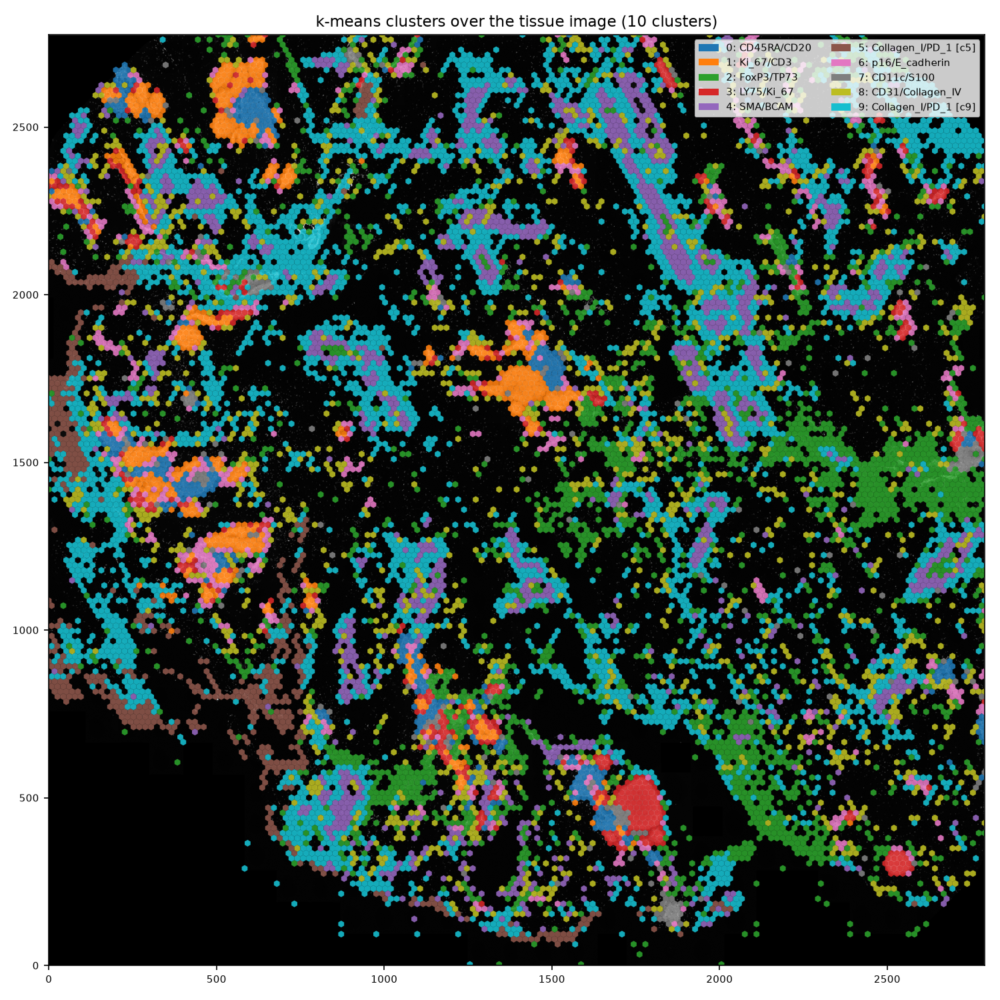
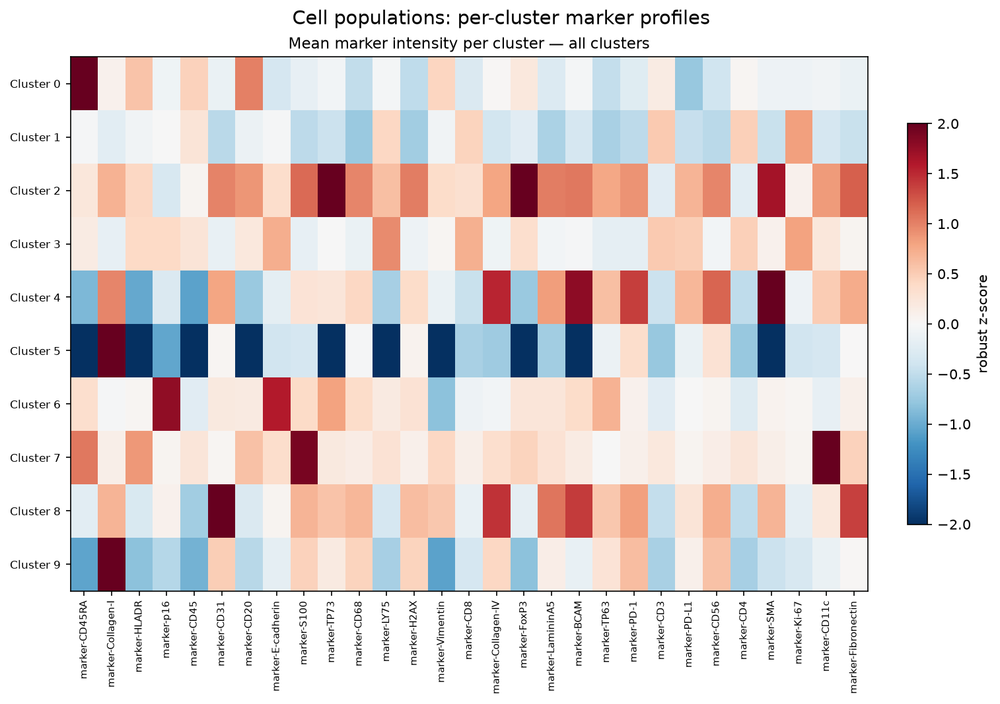

[](https://cell-survey.readthedocs.io/en/latest/) [](https://www.python.org/downloads/) [](https://pixi.sh)  

# Overview

CellSurvey is a Python pipeline for image-based spatial biology/omics analysis built on [Sopa](https://gustaveroussy.github.io/sopa/). It processes multichannel microscopy images (OME-TIFF) into spatial data objects, segments nuclei and whole cells with Stardist or InstanSeg, detects RNA spots via blob detection, clusters cells with k-means, builds Delaunay networks via scipy, detects Louvain communities via networkx, and exports GeoJSON for QuPath visualization.

* Blampey, Q., Mulder, K., Gardet, M. et al. Sopa: a technology-invariant pipeline for analyses of image-based spatial omics. _Nat Commun_ 15, 4981 (2024).

<p align="center">
   
</p>

# Documentation

Full documentation is available at **[cell-survey.readthedocs.io](https://cell-survey.readthedocs.io/en/latest/)** — installation, a pipeline walkthrough, every parameter, the outputs reference, the visualisation guide, and an FAQ.

# Installation

CellSurvey uses **pixi** for environment management targeting Linux (64-bit) with GPU support.

> [!NOTE]
> GPU processing is only supported on Linux (64-bit). Windows (64-bit) environments are CPU-only and intended for local testing; macOS is not supported via pixi. See [here](https://www.tensorflow.org/install) for more information on TensorFlow GPU support.

Each segmenter has its own pixi environment, so TensorFlow and PyTorch are never installed together:

| Environment | Segmenter | Framework |
|---|---|---|
| `default` (alias `spatial`) | Stardist (`--segmenter stardist`, the default) | TensorFlow |
| `instanseg` | InstanSeg (`--segmenter instanseg`) | PyTorch |

The project plans to migrate fully to InstanSeg and eventually drop Stardist.

## Pixi (recommended)

[Pixi](https://pixi.sh/latest/) manages the full environment including Python, CUDA, cuDNN, and all Python packages in a single command.

First, [install pixi](https://pixi.sh/latest/#installation) if you haven't already:

```bash
curl -fsSL https://pixi.sh/install.sh | bash
```

From the repository root:

```bash
pixi install
```

That's it ,  pixi reads `pixi.toml` and sets up everything. To run:

```bash
pixi run python run.py -i <input_tiff> -o <output_zarr> -p <plot_dir>
```

To use InstanSeg, install and run the `instanseg` environment instead:

```bash
pixi install -e instanseg
pixi run -e instanseg python run.py -i <input_tiff> -o <output_zarr> -p <plot_dir> --segmenter instanseg
```

## Docker

```bash
docker build -t cellsurvey .
docker run --gpus all -v /path/to/data:/data cellsurvey -i /data/input.tiff -o /data/output -p /data/plots
```

For InstanSeg, build with the `instanseg` environment:

```bash
docker build --build-arg PIXI_ENV=instanseg -t cellsurvey-instanseg .
docker run --gpus all -v /path/to/data:/data cellsurvey-instanseg -i /data/input.tiff -o /data/output -p /data/plots --segmenter instanseg
```

# Usage

## Basic Usage

```bash
pixi run python run.py -i <path_to_input_file> -o <path_to_output_zarr> -p <path_to_output_plots_directory>
```

## Parameters

A full reference of every flag, with tuning guidance, is in the
[Parameters](https://cell-survey.readthedocs.io/en/latest/parameters/) page. The
three required arguments are:

* `-i`, `--input_file`: Path to the input multichannel TIFF image (OME-TIFF recommended).
* `-o`, `--output_file`: Path for the output Zarr (`.zarr` appended automatically).
* `-p`, `--plot_dir`: Directory where output plots are saved.

Key segmentation options:

* `--segmenter {stardist,instanseg}`: Segmentation method (default `stardist`; `instanseg` needs the `instanseg` environment).
* `--cell-expansion`: Stardist only — radius in µm to expand nuclei into whole cells (default `5.0`; `0` = nuclei only).
* `--pixel-size`: Pixel size in µm/px, overriding the image metadata. Required if the image lacks it, because all distance flags (`--max-edge-distance`, `--radius-min`/`--radius-max`, `--cell-expansion`) are in µm.
* `--seg-channels`: Comma-separated channel indices to segment on (default `0` for Stardist, all channels for InstanSeg).
* `--keep-unnucleated`: InstanSeg only. Keep cells that contain no nucleus (dropped by default).

## Full Example

```bash
pixi run python run.py -i ~/data/sample.tiff -o ~/results/output -p ~/results/plots/
```

## Stability sweep

To explore how clustering responds to its parameters without re-running the
expensive segmentation, use the read-only sweep over an existing segmented Zarr.
Results are written to CSVs in the same directory as the Zarr.

Sweep the Louvain resolution (and Delaunay edge distance, in µm) for communities:

```bash
pixi run python -m cellsurvey.stability \
  --zarr <output>_seg.zarr \
  --resolutions 0.1,0.05,0.02,0.01 \
  --max-edge-distances 25,50,100
```

For a `_seg.zarr` written before pixel sizes were stored in it, add `--pixel-size <µm/px>`.

Or sweep the k-means `k` (defaults to `5,8,10,12,15,20`):

```bash
pixi run python -m cellsurvey.stability \
  --zarr <output>_seg.zarr \
  --mode clusters
```

Each writes per-cell labels (plus a summary CSV with the community count, or the
k-means inertia) and leaves the Zarr untouched. Both use the `cell_boundaries`
layer if present, else the nuclei layer; override with `--cell-boundaries <layer>`.

# Visualising Results

For the full visualisation guide — Odon (recommended), QuPath, TissUUmaps, and
napari + napari-spatialdata, with performance notes — see the
[Visualising results](https://cell-survey.readthedocs.io/en/latest/visualization/)
page.
