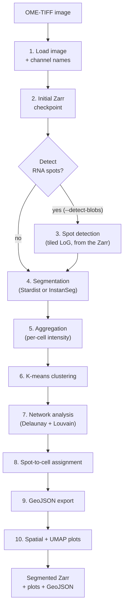

# Pipeline

CellSurvey turns a multichannel image into labelled cells and communities in a
sequence of ten stages. This page walks through each stage: what it does, what
it takes in, and what it produces.

!!! tip "Just want to run it?"
    If you only need the command, see [Getting started](getting-started.md).
    This page is for understanding *how* the result is produced.

## Overview

Each stage is described below, with the module/function that performs it.

---

## 1. Image loading

Reads the input image and discovers its channel (marker) names.

- **What it does**: opens the multichannel image lazily with `sopa.io.ome_tif()`
  (channel names from the OME-XML) and reads the physical pixel size from the
  OME metadata via `bioio`.
- **Input**: an OME-TIFF (or plain multi-channel TIFF).
- **Output**: a lazy image with its channel names and pixel size.
- **Where**: `cellsurvey/image_source.py` (`open_image_source`).

The input image is read **only here, once**: stage 2 copies it into
`<output>.zarr`, and every later stage reads that copy. With `--resume-from`
the input image is not opened at all; the pixel size is taken from the Zarr.

!!! note "Input format"
    Only **multi-channel TIFF** is supported (`.ome.tiff`, `.tiff`, `.tif`).
    ND2 / CZI / LIF / DV and single-channel 2D images are not currently
    accepted. See [FAQ](faq.md).

## 2. Initial Zarr write

Writes the image to disk as a SpatialData Zarr store.

- **What it does**: persists a clean checkpoint before the expensive
  segmentation step. The pixel size and the input's location are recorded in
  the store (`attrs['cellsurvey']`).
- **Output**: `<output>.zarr`.
- **Where**: `cellsurvey/cli.py` and `cellsurvey/image_source.py`.

## 3. Spot / blob detection (optional)

Detects RNA spots, only when `--detect-blobs` is passed.

- **What it does**: for each configured channel of the image in `<output>.zarr`,
  runs tiled Laplacian-of-Gaussian blob detection (`skimage.feature.blob_log`),
  parallelised with `dask`. Overlapping tiles and overlap-region filtering avoid
  double counting at tile seams. Only the selected channels are read.
- **Input**: the channel subset specified by `--channels`, read from the Zarr.
- **Output**: a `spots` points layer added to `<output>.zarr`.
- **Where**: `cellsurvey/blob_detection.py` (`detect_spots`, `detect_blobs_tiled`).

The channels and their thresholds are set with `--channels` and `--thresholds`
(must have equal length). See [Parameters](parameters.md).

When resuming (`--resume-from`) with `--detect-blobs`, spots already in the Zarr
are reused. If the Zarr has none (e.g. a run that crashed during spot detection),
they are detected then, unless an existing segmented Zarr is being reused, in
which case a warning says to re-run without `--resume-from`.

## 4. Segmentation

Segments nuclei and whole cells, with one of two segmenters chosen by
`--segmenter`.

- **What it does**: detects a GPU (with `--use-gpu` requesting it if
  auto-detection fails), makes image patches, then runs the chosen segmenter on
  the `--seg-channels`.
- **Input**: the initial Zarr (`<output>.zarr`).
- **Output**: nucleus and cell shape layers (see below).
- **Where**: `cellsurvey/segmentation.py` (`run_stardist`, `run_instanseg`).

| | Stardist (default) | InstanSeg |
|---|---|---|
| Environment | `default` (TensorFlow) | `instanseg` (PyTorch) |
| Model | `2D_versatile_fluo` | `fluorescence_nuclei_and_cells` (`--instanseg-model`) |
| Channels | One (`--seg-channels`, default `0`) | All by default (channel-invariant) |
| Nuclei layer | `stardist_boundaries` | `nucleus_boundaries` |
| Cell layer | `cell_boundaries`, by expanding nuclei (stage 5) | `cell_boundaries`, segmented directly |

**InstanSeg** segments nuclei and cells together, so each nucleus lies inside
its own cell. Each cell is then linked to the largest nucleus it contains
(matched on a point inside each nucleus), recorded in a `nucleus_id` column.
Cells with no nucleus, which are mostly fragments of cytoplasm, are dropped
unless you pass `--keep-unnucleated`. In that case they get an empty `nucleus_id`. It uses the
pixel size (from the metadata or `--pixel-size`) to rescale the image to the
model's training resolution; without it, it may find few or no cells.

!!! warning "CPU fallback"
    If no GPU is found, segmentation runs on CPU — this works but is very slow.
    See [FAQ](faq.md).

### Resume / crash recovery

When `--resume-from` is set, the pipeline first checks whether a segmented Zarr
(`*_seg.zarr`) already exists:

| Existing `*_seg.zarr` state | What happens |
|---|---|
| Has a table | Skips segmentation **and** aggregation, jumps straight to clustering. |
| Has the chosen segmenter's layers but no table | Skips segmentation, re-runs aggregation only. |
| Missing or unreadable | Deletes it and re-runs the full segmentation + aggregation. |

The "segmenter's layers" are `stardist_boundaries` for Stardist, and both
`nucleus_boundaries` and `cell_boundaries` for InstanSeg.

## 5. Channel aggregation

Measures the mean intensity of every channel inside every cell.

- **What it does**: for Stardist, first expands each nucleus into a whole cell
  (see below). Then runs `sopa.aggregate()` to compute per-cell mean intensities
  over `cell_boundaries`, or over the nuclei layer if there is no cell layer.
  If a `spots` layer is present, it also assigns spots to cells
  (`aggregate_genes=True`).
- **Input**: the segmented dataset.
- **Output**: an AnnData table (`table`) of cells × markers.
- **Where**: `cellsurvey/cli.py`.

### Cell expansion (Stardist only)

Stardist finds nuclei only, so whole cells are approximated by growing each
nucleus outward by `--cell-expansion` µm (default `5.0`). The growth is a
marker-controlled watershed, so neighbouring cells stop where they meet instead
of overlapping — the same approach as QuPath's cell detection. The result is
written to `cell_boundaries`, with a `nucleus_id` column pointing back to the
nucleus each cell grew from.

Expansion is skipped — and the analysis runs on nuclei alone — when
`--cell-expansion 0` is set. (A pixel size is always available: the run stops at
startup if the image has none and `--pixel-size` is not given.) InstanSeg
segments cells directly, so
`--cell-expansion` is ignored for it.

## 6. K-means clustering

Groups cells by their expression profile.

- **What it does**: builds the per-cell features chosen by `--cluster-on`
  (channel intensities, spot densities, or both; each z-scored across cells, see
  [Parameters](parameters.md)) and runs k-means with `--n-clusters`. The same
  features weight the network edges (stage 7) and drive UMAP/Leiden.
- **Output**: a `kmeans_cluster` label per cell.
- **Where**: `cellsurvey/utils.py` (`cluster_data`).

## 7. Network analysis

Builds a spatial network of neighbouring cells and detects communities.

- **What it does**: extracts cell centroids, builds a `scipy.spatial.Delaunay`
  triangulation, filters edges longer than `--max-edge-distance` (µm, converted
  to pixels with the image's pixel size), weights the
  remaining edges by the similarity of the two cells' `--cluster-on` features
  (`1 + Pearson correlation`), and runs
  Louvain community detection (`networkx`) at `--community-resolution`.
- **Output**: `kmeans_cluster` and `community` labels, plus `summary.json`
  (cell / cluster / community / edge counts).
- **Where**: `cellsurvey/network_analysis.py` (`run_network_analysis`).

The network, and all later stages, use `cell_boundaries` when present, else the
nuclei layer. The labels are written to the cell layer, and copied to the nuclei
layer through each cell's `nucleus_id`. Nuclei not linked to a cell (for
example, the extra nuclei of a multinucleate InstanSeg cell) get `-1`.

!!! info "Deterministic"
    Both k-means and Louvain use a fixed random seed (42), so the same input and
    parameters give the same result.

!!! tip "Clusters vs communities"
    These two labels answer different questions and are easy to confuse:

    - **Clusters** (`kmeans_cluster`) group cells by **expression** — cells with
      similar marker profiles, wherever they sit in the tissue.
    - **Communities** (`community`) group cells by **space** — cells that sit next
      to each other in the tissue, regardless of whether they share markers.

    So one cell type often appears in many communities (e.g. CD31⁺ vessels are
    spatially separated, so each vessel is its own community), while a cluster
    groups that cell type into a single label across the whole tissue.

## 8. Spot-to-cell assignment

Assigns each detected spot to the cell that contains it.

- **What it does**: a spatial join of spots to cell boundaries
  (`gpd.sjoin(predicate='within')`).
- **Output**: each spot linked to a `cell_id` (or left unassigned).
- **Where**: `cellsurvey/utils.py` (`assign_spots_to_cells`).

If no spots were detected, this stage is skipped entirely.

## 9. QuPath GeoJSON export

Exports everything for viewing in QuPath.

- **What it does**: writes cell boundaries and (optional) spots as GeoJSON
  features, coloured by community, with cluster and per-marker measurements.
- **Output**: the file at `--geojson-path` (default `<output>.geojson`, next to the Zarr stores).
- **Where**: `cellsurvey/export.py` (`export_to_qupath`).

## 10. Spatial neighbourhood and visualisation

Produces the summary plots and persists the final result.

- **What it does**: computes a spatial-neighbours radius graph and mean-hop
  distance between clusters, UMAP embeddings, and Leiden clustering, then renders
  the plots below. Finally it writes the segmented Zarr
  (`<output>_seg.zarr`).
- **Where**: `cellsurvey/cli.py`.

### Generated plots

| File | What it shows |
|---|---|
| `cell_type_to_cell_type.png` | Mean hop distance between clusters |
| `umap_kmeans_cluster.png` | UMAP coloured by k-means cluster |
| `umap_leiden.png` | UMAP coloured by Leiden cluster |
| `cell_density.png` | Per-cluster and per-community spatial density maps |
| `cluster_intensity_heatmap.png` | Mean channel intensity per cluster |
| `morphology_by_cluster.png` | Cell area by cluster (only if `area` is present) |

All plots are written to `--plot_dir`; the segmented Zarr goes next to
`--output_file`.

---

Next: [Parameters](parameters.md) for the full list of options and tuning
guidance.
